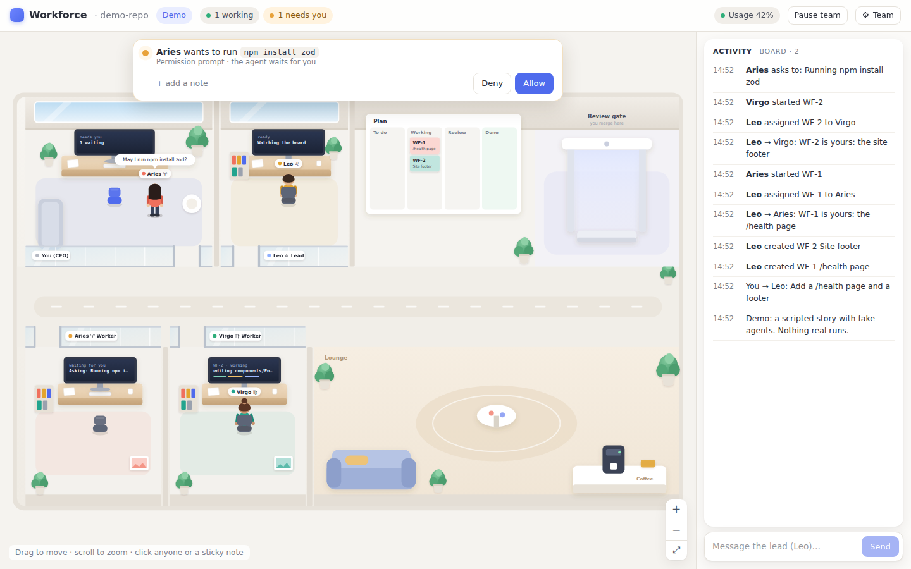

# Workforce

Run a small team of **Claude Code** agents on your GitHub projects, and watch them work in a live office.

You are the CEO. **Leo** (the lead) turns your request into small tasks and hands them out. The workers (**Aries**, **Virgo**, …) each build one task in their own copy of the repo and open a pull request. Review comments go back to the right agent. **You merge; agents never do.**



## What you get

- **The office:** every agent has a cabin; you see them type, walk to each other to talk, and come to your CEO cabin when they need you.
- **Needs you:** permission prompts (Allow / Deny), questions, and PRs ready to merge, in one strip at the top.
- **Live terminals:** watch and type into any agent's Claude Code session, plus a plain shell in its folder.
- **Plan wall and boards:** tasks move To do → Working → Review → Done.
- **GitHub loop:** a PR titled `[ID] …` is linked to its task; review comments and failed checks go to the author; merged = Done.
- **Settings:** team (zodiac signs or your own agents), stack skills, MCP servers, per-agent env (names only reach agents), workflow (reviewer, who merges, build step), ports, setup checklist, debug.
- **Usage guard:** pauses the team at 90% of your weekly Claude limit.
- **Demo mode:** open `/?demo=1` to see it all with fake agents.

## Requirements

Linux or macOS with: Node 24+, git, tmux, the GitHub CLI (`gh`, logged in), and Claude Code (`claude`, logged in).

## Run it

```bash
git clone https://github.com/Kanav-Chauhan/Workforce.git && cd Workforce
npm install && npm --prefix web install
npm run build:web
npm run server            # http://127.0.0.1:3010
```

The first visit shows a welcome screen and a setup checklist. Add a project by its GitHub name (`owner/repo`), press **Start team**, and type to the lead.

Data lives in `~/.workforce` (one SQLite file, the agents' clones, env files). Nothing is added to your repo. Agents run in tmux (`tmux -L workforce ls`), so they keep working when you close the browser or restart the server.

## On a server

Workforce listens on 127.0.0.1 only. Put a login in front of it (for example Caddy with `basic_auth`) and proxy to port 3010; WebSockets (`/live`, `/term/…`) must pass through. The live terminal can type into an agent's shell, so **never expose it without a login**. See `deploy/workforce.service` for a systemd unit.

## Safety

- Each agent works only in its own folder; `~/.ssh`, other agents' folders and `docker` are always blocked.
- **Careful** permission style (default): every shell command asks you. **Trusted**: only risky ones ask; use it for throwaway repos.
- Agents never merge (unless you turn on "lead may merge") and never deploy.

## Tests

```bash
npm test && npm run typecheck
```

## Licence

MIT © 2026 Kanav Chauhan
